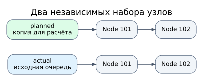
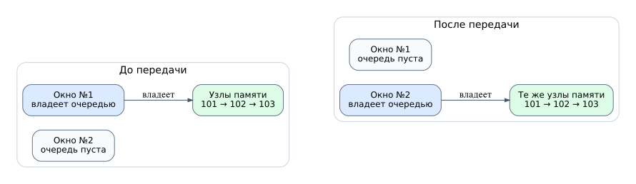
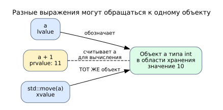
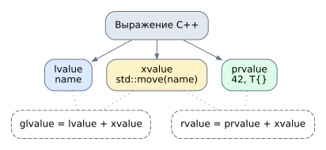

#  Проект "Электронная очередь": RAII, move-семантика, умные указатели

Представьте обычную электронную очередь. Посетитель берёт талон №101, ждёт вызова, сотрудник приглашает его к окну, а табло показывает номер. Сперва мы рассматриваем очередь целых чисел (номеров талонов). В дальнейшем у талона появится имя посетителя, затем несколько частей программы захотят работать с одним талоном, а в конце появятся подписчики на уведомления.

---

## 1. RAII

Очередь устроена по принципу FIFO: кто пришёл раньше, обслуживается раньше. На первом этапе она хранит номера в связанных узлах. Каждый узел содержит число и указатель на следующий узел:

```cpp
struct Node {
    int number;
    Node* next = nullptr;
};
```

Когда вызываем `push(101)`, программа создаёт узел через `new`. Когда вызываем `pop()`, удаляет первый узел через `delete`. Но что произойдёт, если функция завершится, пока в очереди ещё есть номера? Без дополнительной заботы оставшиеся узлы не будут освобождены.

Естественное решение — поручить освобождение памяти самой очереди. В `include/ticket_queue.hpp` класс `TicketQueue` хранит указатели `first_`, `last_` и имеет деструктор:

```cpp
~TicketQueue() {
    while (!empty()) {
        pop();
    }
}
```

В `src/main.cpp` переменная `TicketQueue line;` — обычный локальный объект. При выходе из его области видимости вызывается деструктор, который освобождает оставшиеся узлы.

Так устроен **RAII** (*Resource Acquisition Is Initialization*): ресурс связывают со временем жизни объекта. Ресурсом здесь является выделенная динамическая память; объект отвечает за её освобождение. 

---


## 2. Rule of three

**Rule of Three (правило трёх)** говорит: если класс сам управляет ресурсом и ему нужен особый деструктор, то обычно приходится подумывать три связанные операции — деструктор, конструктор копирования и копирующее присваивание. Это не требование писать три функции для каждого класса. Это напоминание: владение ресурсом делает простое копирование потенциально опасным.

Конструктор копирования по умолчанию  выполняет поверхностное (shallow) копирование указателей на узлы, что влечёт двойное освобождение памяти в деструкторе. Надо реализовать глубокое копирование: копироваться должны не только указатели, а сами ресурсы, которыми владеет объект. 



В `include/ticket_queue.hpp` конструктор копирования:

```cpp
TicketQueue(const TicketQueue& other);
```

Он перебирает номера из `other` и добавляет каждый номер в новую цепочку через `push`. `const TicketQueue&` означает, что исходную очередь читают по ссылке и не изменяют.

Теперь различим создание и присваивание:

```cpp
TicketQueue copy = actual;   // Создаётся новый объект: конструктор копирования.
TicketQueue plan;
plan.push(103);
plan.push(104);
plan = actual;               // Объект уже существует: оператор присваивания.
```

Во втором случае очередь `plan` уже владеет узлами 103 и 104. Нельзя просто забыть их адреса: возникнет утечка. Нельзя и сначала удалить содержимое `plan`, а потом  копировать: если выделение памяти завершится исключением, старое содержимое будет потеряно. Сначала надо сделать временную глубокую копию `actual`, затем обменять её содержимое с `plan` (`swap`). Старые узлы `plan` окажутся во временном объекте и удалятся его деструктором. Если создать копию не получилось, `plan` останется без изменений. Такая идиома называется **copy-and-swap**.

---

## 3. Одно окно закрывается: почему очередь выгоднее переместить

### 3.1. Move семантика

У окна №1 ждут три человека: 101, 102 и 103. Окно закрывается, и принимать посетителей будет окно №2. Самих людей мы, конечно, не дублируем. Нам нужно передать второму окну список ожидающих, а список у первого больше не нужен.

На прошлом этапе мы научились копировать очередь. Такое действие полезно, когда одновременно нужны две независимые очереди. Сейчас наоборот: две очереди не нужны. Если скопировать узлы, мы потратим время и память на дублирование данных, а затем будем уничтожать исходные узлы.



В нашей реализации `TicketQueue` содержит три поля — указатели на первый и последний узлы и число номеров. Сам объект очереди и узлы, созданные через `new`, занимают разные участки памяти. Поэтому передача очереди может сводиться всего к трём действиям: новое окно получает адреса узлов и размер, старое обнуляет свои указатели и размер, узлы остаются на прежних адресах.

**Move-семантика** (**семантика перемещения**) позволяет определить для типа эту операцию: как создать или изменить один объект, используя ресурсы другого, содержимое которого сохранять больше не требуется. Перемещение не означает, что объект физически переехал в памяти. В нашем случае по-прежнему существуют и `window1`, и `window2`, но цепочка узлов после перемещения принадлежит только `window2`.

### 3.2. Почему нельзя автоматически забирать содержимое любой переменной

Нам хочется записать:

```cpp
TicketQueue window1;
window1.push(101);
window1.push(102);

TicketQueue window2 = std::move(window1);  // Передаём узлы окну №2.
```

Но почему компилятор не должен перемещать при записи `TicketQueue window2 = window1;`? Потому что программист может пользоваться `window1` и дальше. Обычное обращение к существующей переменной не даёт разрешения опустошать её. Нужен способ различать два намерения: «сделать независимую копию» и «разрешить использовать старые ресурсы».

Для этого C++ учитывает **категорию выражения**, которым мы обращаемся к объекту. Прежде чем разбирать категории, важно понять, что такое выражение и чем оно отличается от переменной и типа.

### 3.3. Объект, переменная, тип и выражение — не одно и то же

```cpp
int waiting = 3;
int next = waiting + 1;
```

**Тип** `int` описывает, какие значения и операции допустимы. **Объект** `waiting` — сущность программы типа `int` с временем жизни и, в абстрактной модели C++, областью хранения. **Переменная** `waiting` — именованный объект; её имя позволяет обратиться к нему в коде. Здесь объект существует независимо от того, выполняется ли сейчас какое-либо выражение с его именем.

**Выражение** — часть программы, которую можно вычислить. Выражение может вычислить значение, обозначить объект или выполнить побочное действие. Примеры:

```cpp
waiting          // Выражение: обращаемся к существующему объекту waiting.
waiting + 1      // Выражение: вычисляем новое число.
waiting = 5      // Выражение: изменяем waiting, результат обозначает waiting.
std::move(waiting) // Выражение: другой способ обратиться к тому же объекту.
```

У каждого выражения есть тип и категория значения. Это разные характеристики. Например, выражения `waiting`, `waiting + 1` и `std::move(waiting)` имеют тип `int` (без учёта ссылочности при описании типа выражения), но относятся к **разным категориям**. Категория нужна, чтобы компилятор выбирал допустимые действия с результатом выражения: можем ли мы связать с ним изменяемую ссылку, следует ли обращаться с ним как с сохраняемым объектом или можно рассматривать его как источник ресурсов.

### Value categories

Рассмотрим простой пример:

```cpp
int a = 10;
int b = a + 1;
```

`a` — **lvalue-выражение**: оно обозначает конкретный существующий объект `a`. У объекта есть идентичность: можно отличить его от другого объекта, изменить через `a = 20` (если он не `const`), получить адрес `&a`. 

Выражение `a + 1` — **rvalue-выражение** (точнее - `prvalue`, об этом ниже): оно вычисляет число 11, но не обозначает отдельную переменную или уже существующий объект с именем, адрес которого можно получить как `&(a + 1)`. Для такого вычисления компилятору необязательно создавать отдельное место хранения числа 11.

Выражение `std::move(a)` — rvalue (точнее, xvalue, об этом ниже), оно не создаёт копию и не перемещает байты, выражает разрешение рассматривать тот же объект как потенциальный источник ресурсов.



 

### 3.5. Как ссылки связаны с категориями

Ссылка — это способ обратиться к объекту без создания его копии. Вид ссылки задаётся в объявлении параметра, а категория вычисляется у выражения-аргумента. Компилятор сопоставляет их при выборе функции:

| Параметр | Какой аргумент принимает | Для чего обычно используют |
|---|---|---|
| `T&` | Изменяемое lvalue | Изменить уже существующий объект вызывающего кода |
| `const T&` | lvalue и rvalue (при подходящем типе) | Читать без копирования, не изменяя объект через ссылку |
| `T&&` | Неконстантное rvalue | Когда функция может изменять временный объект или забирать его ресурсы |

Сама передача через `T&&` не перемещает объект: операция произойдёт только в теле функции или конструктора, если они её выполнят.

### 3.6. Пример перегрузки по ссылкам

Представим простой список сохранённых сообщений. Его метод `add` получает `std::string`. Одно и то же сообщение можно сохранить двумя способами:

* Пользователь передал свою существующую строку, которую собирается использовать и дальше. Архив должен скопировать текст, не меняя исходную строку.

* Пользователь создал временную строку или явно больше не собирается пользоваться старой. Архив может переместить содержимое в свой `vector`, не создавая ненужную копию символов.

```cpp
class MessageArchive {
    std::vector<std::string> messages_;

public:
    void add(const std::string& message) {
        messages_.push_back(message); // Копия: старый текст остаётся у вызывающего кода.
    }

    void add(std::string&& message) {
        messages_.push_back(std::move(message)); // Передаём ресурсы строки в vector.
    }
};
```

Вызовы:

```cpp
MessageArchive archive;
std::string draft = "Встреча в пятницу";
const std::string important = "Не удалять";

archive.add(draft);                          // const string&: копируем draft.
archive.add(important);                      // const string&: копируем important.
archive.add(std::string{"Новое сообщение"}); // string&&: перемещаем временную строку.
archive.add(std::move(draft));               // string&&: разрешаем переместить draft.
```

Почему после выбора перегрузки ещё нужен `std::move(message)` внутри неё? Потому что `message` — имя параметра. Выражение, состоящее из имени переменной, всегда lvalue, даже если тип параметра `std::string&&`. Если написать `messages_.push_back(message)`, контейнер выберет копирование. Запись `std::move(message)` снова превращает выражение в подходящее для перемещения.

А зачем тогда `T&`? Когда задача — изменить объект вызывающего кода на месте, а не сохранить его в архиве:

```cpp
void add_exclamation(std::string& text) {
    text += "!";  // Меняем именно строку, которую передал вызывающий код.
}

// add_exclamation(important);            // Не компилируется: строка const.
// add_exclamation(std::string{"Привет"}); // Не компилируется: prvalue не T&.
add_exclamation(draft);                 // Допустимо: draft — изменяемое lvalue.
```

Первые два вызова закомментированы, потому что компилятор их отвергнет. У `T&`, `const T&` и `T&&` разные роли. Не стоит создавать все три перегрузки автоматически: для `MessageArchive::add` достаточно двух, потому что изменять исходную строку на месте архиву не нужно.



Откройте `examples/value_categories.cpp` и запустите `./build/value_categories_demo`. Там этот архив реализован полностью. Программа выводит, какой вариант `add` вызвался, а отдельный тип `Tracer` показывает выбор копирующего или перемещающего конструктора. Различайте три шага: *категория аргумента → выбор перегрузки → выполняемые действия внутри неё*.

### 3.7. Уточняем категории: lvalue, prvalue и xvalue

Мы уже увидели, что разные rvalue ведут себя по-разному. В C++17 есть три **основные, непересекающиеся категории**:

| Категория | К чему относится выражение | Пример | Что важно |
|---|---|---|---|
| **lvalue** | Обозначает объект или функцию с идентичностью | `draft`, `*ptr` | Обычно мы хотим сохранить доступ к этому объекту; изменяемое lvalue связывается с `T&` |
| **prvalue** | Вычисляет значение, используемое, например, для инициализации объекта | `5 + 1`, `std::string{"Текст"}` | В C++17 результат может сразу создавать объект в месте назначения без лишнего move (copy elision, об этом ниже) |
| **xvalue** | Обозначает существующий объект с идентичностью, ресурсы которого разрешено повторно использовать | `std::move(draft)` | Для неконстантного объекта может связаться с `T&&` и выбрать перемещение |

Термины `glvalue` и `rvalue` — объединения: `glvalue = lvalue ∪ xvalue` (выражение обозначает объект с идентичностью), `rvalue = prvalue ∪ xvalue`. Это не ещё две отдельные основные категории. То есть `std::move(draft)` одновременно xvalue и rvalue, но не prvalue. Оно обозначает старый объект `draft`; выражение `std::string{"Текст"}` — prvalue, которое создаёт новое значение.

Категория выражения определяет семантику обращения к объекту/значению и участвует в правилах перегрузки.

### 3.8. `std::move` не перемещает: перемещает выбранная операция

`std::move(obj)` — преобразование, дающее xvalue для неконстантного `obj`. Само по себе оно ничего не меняет (даже если результат сохранить в ссылке):

```cpp
std::string text = "Привет";
auto&& view = std::move(text);       // Получена ссылка: text ещё прежний.
std::string another = std::move(view); // Теперь вызвана move-операция строки.
```

После настоящего перемещения исходный объект остаётся существовать и его можно уничтожить или присвоить ему новое значение. Но конкретное содержимое перемещённого `std::string` не следует предполагать. Говорят, что перемещённый объект находится в *согласованном, но неопределённом состоянии*. У нашего `TicketQueue` мы явно договорились делать исходную очередь пустой.

Ещё два случая:

```cpp
std::string&& ref = std::string{"Временная"};
// ref — переменная ссылочного типа; выражение ref — lvalue!
std::string taken = std::move(ref);  // Чтобы переместить, нужен xvalue.

const std::string fixed = "Постоянная";
std::string copy = std::move(fixed); // Копирование: const нельзя отдать в string&&.
```

### 3.9. Возвращаемся к `TicketQueue`: реализуем Rule of Five

Теперь понятно, почему у очереди два разных конструктора:

```cpp
TicketQueue(const TicketQueue& other); // Создаёт новые узлы, сохраняет other.

TicketQueue(TicketQueue&& other) noexcept
    : first_(other.first_), last_(other.last_), size_(other.size_) {
    other.first_ = nullptr;
    other.last_ = nullptr;
    other.size_ = 0;
}
```

`TicketQueue copy = window1;` выбирает копирование. `TicketQueue next = std::move(window1);` выбирает перемещение. В move-конструкторе мы передаём три поля, не перемещая сами узлы по адресам. Старая очередь становится пустой, поэтому её деструктор ничего не удалит из новой очереди.

В `include/ticket_queue.hpp` найдите и move-присваивание: `window2 = std::move(window1)` заменяет содержимое уже существующего `window2`. Старые узлы `window2` тоже нужно освободить. Для этого проект использует `swap` и временный объект. Пометка `noexcept` отражает, что перенос этих указателей не должен бросать исключений; это важно и стандартным контейнерам, например `std::vector`, когда они решают, перемещать или копировать элементы при расширении.

Итак, для класса, который сам владеет динамическими узлами, приходится продумать пять связанных специальных функций: деструктор, копирующий и перемещающий конструкторы, копирующее и перемещающее присваивание (**Rule of Five**).

Итог: категории выражений отвечают на вопрос, какое обращение к объекту описывает код; ссылки и перегрузки позволяют отличить чтение/копирование от разрешения использовать старые ресурсы; move-конструктор и move-присваивание выполняют само перемещение.

---

## 4. А нельзя ли не писать эти пять функций? Rule of Zero

Ручное управление цепочкой было полезно для понимания: мы увидели, почему нельзя копировать только указатели, и что означает «забрать ресурс». Но в обычной программе такая реализация только усложняет жизнь. В C++ уже есть контейнер `std::queue` — он сам управляет выделением и освобождением памяти.

Теперь `TicketQueue` хранит:

```cpp
std::queue<int> numbers_;
```

Деструктор, копирующий и перемещающий конструкторы и операции присваивания больше не написаны нами. Компилятор может сгенерировать корректные операции для `TicketQueue`, потому что `std::queue` умеет копироваться, перемещаться и освобождать собственную память. Это **Rule of Zero**: если класс не управляет ресурсом непосредственно, не нужно вручную писать специальные функции управления временем жизни.

---

